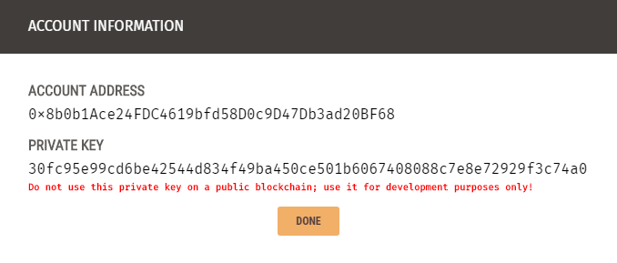
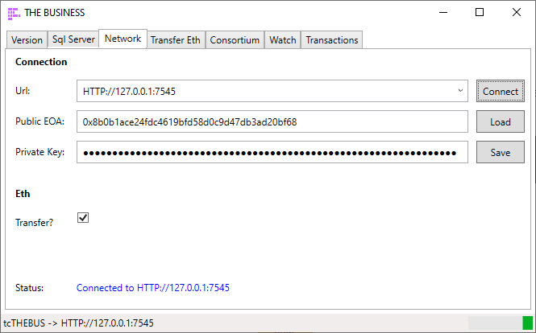
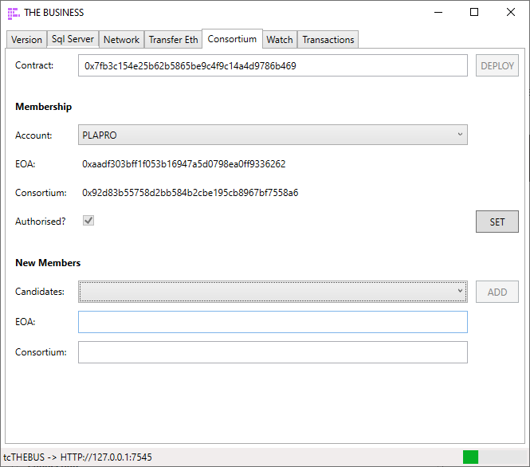
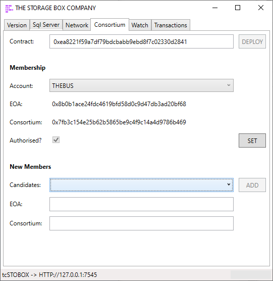
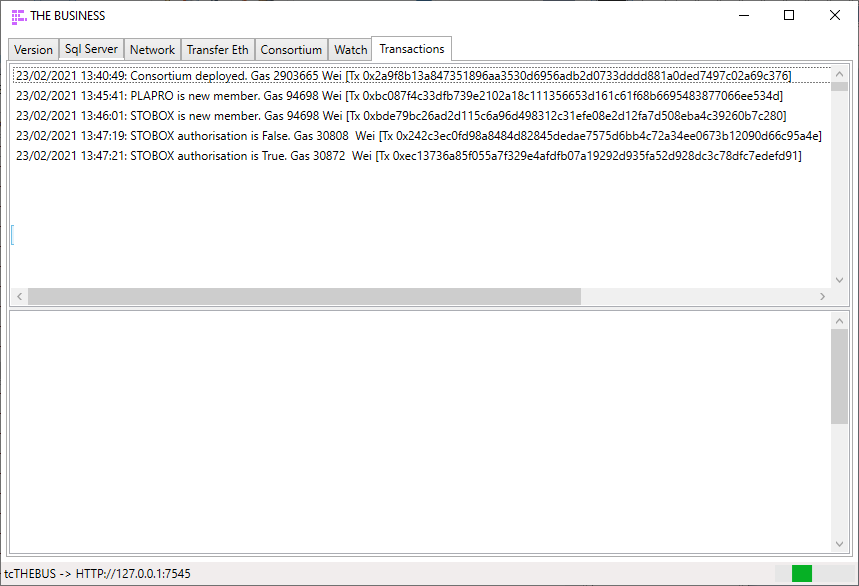
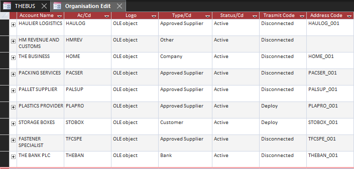

# Installing the Ethereum Network

The Trade Control network is built on smart contracts running on the Ethereum Virtual Machine. To run the network for testing or [learning](/tutorials/network), you will need local instances of Ethereum and Sql Server.

## Networks

### Test Environment

- [NVM for Windows](https://github.com/nvm-sh/nvm)
- [Ganache](https://github.com/trufflesuite/ganache)
- Sql Server Instance (such as Express)

### Public Network

[Infura](https://infura.io/) (or something similar)

### Dependencies

- [Node](https://github.com/tradecontrol/sqlnode) - Fiat >= 3.27.1; Bitcoin >= 3.28.3
- [Office](https://github.com/tradecontrol/office) - Fiat >= 3.13.1; Bitcoin >= 3.14.1

## Setup

[install the latest release - tcNetwork.zip](https://github.com/tradecontrol/network/releases)

For live environments, you just must configure a single node on the public network.

The following explains how to install and configure a supply-chain of nodes for [the tutorial](./docs/network.md). 

### Database

Firstly, we create a simple supply chain in the form Retail -> Secondary Industry -> Primary Industry. Because we will be simulating the actions of three separate business entities, it may seem more complicated than it is. In a live environment you would only interact with the network from the vantage of a single entity. 

1. Create three databases: tcTHEBUS, tcPLAPRO and tcSTOBOX with corresponding 64bit ODBC data sources.
2. Configure each database using the [node installer](https://github.com/tradecontrol/sqlnode) with a different business name for each (e.g. THE BUSINESS, PLASTICS PROVIDER, THE STORAGE BOX COMPANY). Accept the other defaults, including the Basic Configuration page.
3. Install the [BOM Tutorial](https://github.com/tradecontrol/office) into tcTHEBUS, **Activities option only**.
4. Open the client and for each database [set up a connection](https://github.com/tradecontrol/office).
5. Optionally, [copy the Office interface](https://github.com/tradecontrol/office/blob/master/src/access) into two additional folders and run [the client](https://github.com/tradecontrol/office/blob/master/src/access/TCnode_3.accde) separately for each business. Change the Application Titles to facilitate switching businesses across the supply chain. 
5. Connect to tcPLAPRO and in Organisations, Quick Entry, add account THE BUSINESS as a Customer, specifying payment terms (COD etc) and Standard Rate Vat. Then connect to tcSTOBOX and add THE BUSINESS as a supplier.

> Account Codes do not have to match because each node maps its internal codes to Externally Owned Accounts (EOA).

### Consortium

Secondly, we connect the supply chain together using Ethereum.

- Load Ganache and create a new workspace TRADE-CONTROL. This presents a private offline Ethereum node. Ganache gives each account 100 ETH to play with, so you do not need to transfer currency. Copy the RPC Server address (Remote Procedure Call interface).
- Open the Network Interface, select the tcTHEBUS database in the Sql Server page and connect. Paste the RPC Server address into the Url of the Network and connect.
- From the Ganache Accounts page, use the keys from the first account listed. It will look like this:

- Paste the public and private keys into the Network page and click Save:

- Deploy the byte code of the [Org.sol contract](./tc_network_spec.md) from the Consortium page. It will return a contract address which identifies the location of the Consortium on the blockchain. From Ganache the transaction count is incremented, and the balance is reduced to pay for the administration cost. This is also recorded in the Transactions page of the Network Interface.
- Open another two instances and repeat 2-5 for tcPLAPRO and tcSTOBOX.  Each will then have a unique Public EOA address that owns the contracts and pays the fees, and a Consortium Address to register contract deployments and events.
- We now need to connect the Org contracts to form a consortium using their unique keys. THE BUSINESS will have two members (a customer and supplier), whilst the others will have only one. So, the supply chain is THE STORAGE BOX COMPANY -> THE BUSINESS -> PLASTICS PROVIDER. This is just before the STOBOX keys are added to THE BUSINESS instance:

Here is the STORAGE BOX COMPANY instance as well:

> Make sure the keys are correct because the blockchain is immutable. An error at this stage would involve de-activating the account and re-creating it with a new code.  

- Test everything is working by selecting a member account. The keys should be obtained from the EOA's Org contract. Then set the authorisation status on and off. Because this is a change in the state of the blockchain, there is a transaction cost:  

- Although we are not using the EVM to transact payments, live installations would require that you secure your private key. This is written to table _App.tbEth_; therefore, only the Sql User running the service needs access to this table. The keys of suppliers and customers are stored on the blockchain in the Org contract. At the same time, the **TransmitStatusCode** of the account is set to **Deploy**, determining the communication status of events written to the Task or Invoice change logs. Having added members to the tcTHEBUS consortium, the Organisation datasheet reflects this:

[continue with the tutorial...](./network.md)

